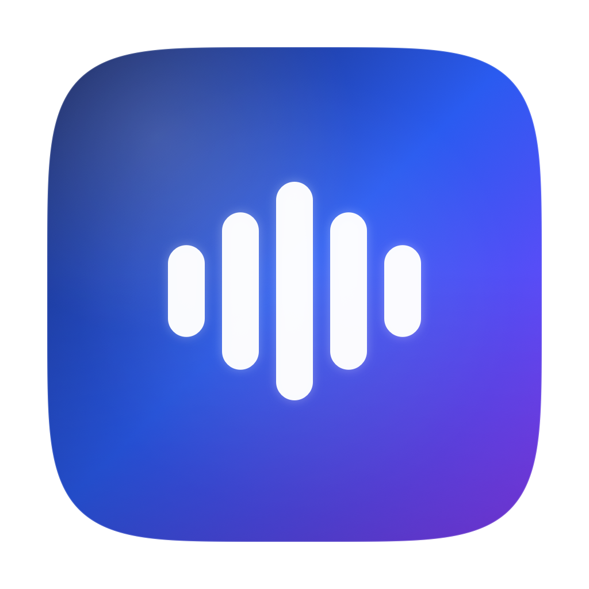
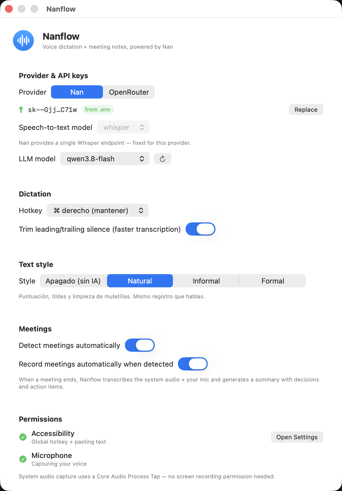
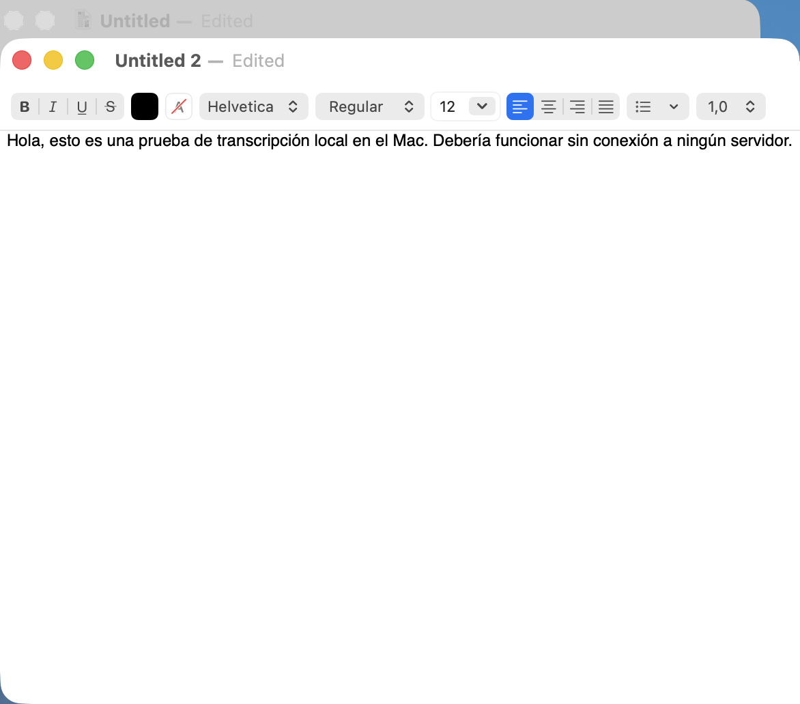
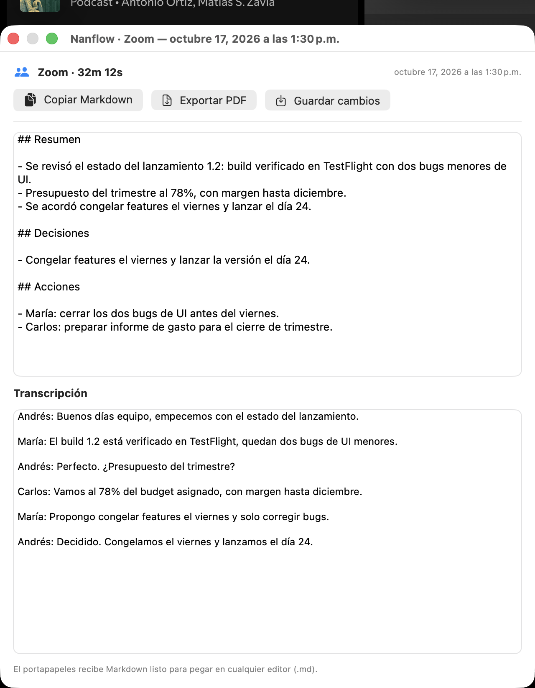
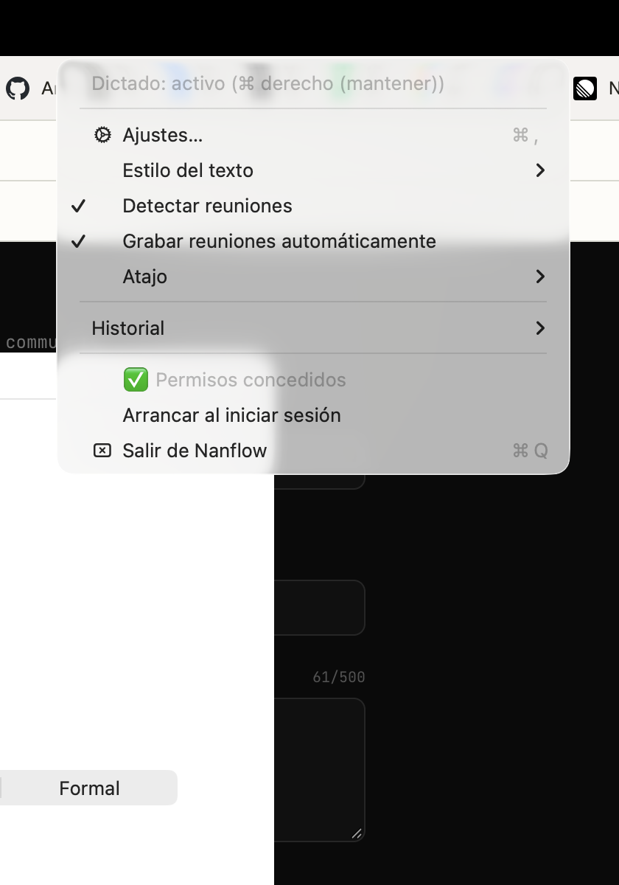

<p align="center">
  
</p>

<h1 align="center">Nanflow</h1>

<p align="center">
  <strong>Hold a key. Speak. Get perfectly formatted text anywhere on your Mac.</strong>
</p>

<p align="center">
  
  
  
  
</p>

---

Nanflow is a **Wispr Flow–style voice dictation app** built natively for macOS. Hold a global hotkey, speak in Spanish or English, release — and a punctuation-perfect version of your words is pasted into whatever app you're typing in. It also **detects meetings** (Zoom, Teams, FaceTime, Webex, Google Meet in the browser), records their audio, and hands you a structured transcript with decisions and action items.

Everything is orchestrated from a small menu-bar app with a native SwiftUI control panel. Audio capture runs locally; speech-to-text and text polishing go through your chosen provider — **Nan** or **OpenRouter**.

## ✨ Features

| | |
|---|---|
| 🎙️ **Hold-to-talk dictation** | Hold ⌘ right (or ⌥ right / Fn / F5), speak, release. A floating bubble shows the mic level while you talk. **Esc cancels** while recording or processing. |
| 🌍 **Spanish & English** | Language is detected per utterance; the formatter always answers in the language you spoke. |
| ✨ **Text styles** | **Off** (raw transcript, no LLM), **Natural**, **Informal**, **Formal** — switchable from the menu bar or the panel. Short Natural phrases skip the LLM (~33 % faster). |
| 🛟 **Never loses a dictation** | If the LLM fails or is unreachable, the raw transcript is polished locally and pasted anyway. Silence is detected before upload (0 ms API time). |
| 🔵 **Meetings** | Detects meetings by app or browser tab, or start one manually from the menu. Records system audio + mic, then transcribes and summarizes: Resumen / Decisiones / Acciones. Editable summary + transcript in a detail window, export to **Markdown (clipboard)** or **PDF**. |
| 🗣️ **Voice commands** | Say "nueva línea", "punto y aparte", "dos puntos", "punto y coma", "coma", "abrir/cerrar paréntesis", "comillas", "punto final" or "pulsa enter" — deterministic, no LLM round-trip. |
| 📖 **Custom dictionary** | List names and terms once; the formatter spells them exactly as written. |
| ⚡ **Snippets** | Trigger phrase → expansion (URLs, emails, whole prompts). An exact match skips the LLM (~0 ms). |
| 🪄 **Transforms** | Resumir, lista de puntos, más formal, más informal, traducir a inglés o corregir gramática sobre tu último dictado — desde el menú, resultado al portapapeles. |
| 📝 **Scratchpad** | A quick notes window; append any dictation with one menu click. Auto-saved as Markdown. |
| 🎚️ **Mic & language** | Pick any input device (per UID) and pin Auto/Español/English. |
| 📊 **Insights** | Total words, average WPM, dictation count and minutes, computed locally from your history. |
| ⚡ **Low latency** | Silence trimming, in-memory WAV upload, shared URLSession + TLS prewarm on press, short-utterance fast path, latency-based provider routing. |
| 🔀 **Two providers** | Nan or OpenRouter, with live model catalogs and per-provider selection. |
| 🔒 **Privacy-first** | Audio travels only to your chosen API. Transcripts, meeting recordings and history never leave your Mac. |

## 📸 Screenshots

| Control panel | Dictation result | Meeting editor & export |
|:---:|:---:|:---:|
|  |  |  |

Quick controls live in the menu bar — no window needed:

<p align="center"></p>

## 🚀 Quick start

```bash
./scripts/build-app.sh release   # build + sign + bundle
open build/Nanflow.app
```

First launch asks for:

1. **Accessibility** — global hotkey + pasting (System Settings → Privacy & Security → Accessibility).
2. **Microphone** — prompted automatically when you first dictate.
3. **Notifications** — meeting alerts (optional).

> System audio capture uses a **Core Audio Process Tap** — it does **not** need Screen Recording permission.

## ⚙️ Providers

Pick your provider on first launch; the control panel opens automatically if no API key is configured.

| | **Nan** | **OpenRouter** |
|---|---|---|
| API key | `NAN_API_KEY` in `.env`, or entered in the panel → Keychain | `OPENROUTER_API_KEY` in `.env`, or Keychain |
| Speech-to-text | Single Whisper endpoint — **fixed**, shown for clarity | **Selectable**: `whisper-large-v3-turbo`, `whisper-large-v3`, `whisper-1` |
| LLM | Selectable (live catalog) | **Selectable** (340+ models, live catalog) |
| Routing | — | Always routed to the **lowest-latency** provider for the selected model |

- Keys already in `.env` appear **masked** in the panel (`sk-or-…472d`) with a `from .env` badge.
- Keys typed into the panel are stored in the **macOS Keychain** — never in plaintext.
- Model lists load from the provider's catalog with a refresh button; selections persist per provider and apply immediately.

### Configuration

`.env` lookup order: `~/.nanflow/.env` → `~/Library/Application Support/Nanflow/.env` → app bundle `Resources/.env` → current directory.

```ini
# Nan (default provider)
NAN_API_KEY=sk-...
NAN_BASE_URL=https://api.nan.builders/v1
NAN_MODEL=qwen3.8-flash            # default LLM (also selectable in the panel)
NAN_WHISPER_MODEL=whisper          # fixed single STT endpoint

# OpenRouter (alternative provider)
OPENROUTER_API_KEY=sk-or-v1-...
OPENROUTER_BASE_URL=https://openrouter.ai/api/v1
STT_OPENROUTER_MODEL=openai/whisper-large-v3-turbo
LLM_OPENROUTER_MODEL=deepseek/deepseek-v4.1-flash
```

Panel choices override `.env` and persist per provider (LLM and STT separately).

## ⏱️ Latency

Measured on an M3 (release build, Nan provider, median of 3 runs, hotkey release → text pasted):

| Case | Total | Notes |
|---|---|---|
| Natural, long clip (~11 s) | ~3.4–4.6 s | Whisper + LLM polish; network-bound |
| Natural, short clip (≤3 words) | ~1.3 s | LLM skipped, deterministic punctuation |
| Same short clip with LLM | ~2.0 s | Baseline before the fast path |
| Silence (no speech) | ~0 ms | VAD rejects it before any upload |

What makes it fast: leading/trailing silence trim (−13 % upload), PCM16 WAV built in memory (no temp files), a shared `URLSession` with TLS prewarm at launch and on hotkey press, LLM skipped for style Off and short Natural phrases, and OpenRouter requests routed with `provider.sort = latency`. If the LLM fails, the transcript is still pasted (local fallback) instead of being lost.

## 🏗️ Architecture

```
┌─ nanflow (menu bar app) ────────────────────────────────────────────┐
│  AppDelegate · SettingsStore · SettingsView (SwiftUI) · BubblePanel │
└──────────┬──────────────────────────────────────────────────────────┘
           │
┌─ NanflowCore ───────────────────────────────────────────────────────┐
│  HotKeyMonitor (CGEventTap, dedicated thread)                       │
│  DictationEngine  ──► MicRecorder (AVAudioEngine → 16 kHz)          │
│      │  trimSilence ─► WavEncoder (in-memory PCM16)                 │
│      │             ─► NanClient.transcribe   ──►  STT API           │
│      └── Formatter (off/natural/informal/formal) ──►  LLM API       │
│  MeetingDetector (bundle IDs + browser tabs, 2 s poll)              │
│  MeetingEngine ──► SystemAudioRecorder (Core Audio Process Tap)     │
│      │            + MicRecorder ─► AudioMixer ─► WAV on disk        │
│      └──► transcribe + summarize ─► HistoryStore (local JSON)       │
│  TextInserter (clipboard backup → ⌘V → restore)                     │
│  ProviderSettings ──► Nan/OpenRouter keys (Keychain > .env),        │
│                       model selection, live catalog fetch           │
└─────────────────────────────────────────────────────────────────────┘
```

- **NanflowCore** — testable library (no GUI required)
- **nanflow** — menu bar app: status item, SwiftUI control panel, floating bubble
- **nanflow-cli** — GUI-free test harness

## 🛠️ Development

```bash
swift build -c release          # build everything
swift test                      # 66 unit tests
./scripts/build-app.sh release  # build/Nanflow.app, signed "Nanflow Dev"
./scripts/build-icon.sh          # regenerate AppIcon.icns and docs/logo.* from scripts/generate-icon.swift

# CLI harness
.build/release/nanflow-cli env                                      # config check
.build/release/nanflow-cli test-llm                                 # LLM ping
.build/release/nanflow-cli models --provider openrouter             # live model catalog
.build/release/nanflow-cli transcribe /tmp/audio.wav                # whisper via active provider
.build/release/nanflow-cli pipeline /tmp/audio.wav --provider openrouter  # transcribe + format, timed
.build/release/nanflow-cli pipeline /tmp/audio.wav --no-fast             # force the LLM path for comparison
.build/release/nanflow-cli pipeline /tmp/silence.wav --no-vad            # simulate the old silence upload
.build/release/nanflow-cli record-test --secs 3                     # real mic → full pipeline
.build/release/nanflow-cli tap-test                                 # system audio → whisper
.build/release/nanflow-cli meeting-test --secs 8                    # meeting engine end-to-end
.build/release/nanflow-cli detect                                   # meeting detection status
```

Runtime state: `~/Library/Application Support/Nanflow/` (`history.json`, `meetings/`, `nanflow.log`). Event-tap debug: `defaults write com.nanflow.nanflow nanflow.debug.taplog -bool true`.

### Testing without a mic

```bash
say -v Monica -o /tmp/test.aiff "texto de prueba"
afconvert -f WAVE -d LEI16@16000 -c 1 /tmp/test.aiff /tmp/test.wav
# with the app running (Accessibility granted):
osascript -e 'tell application "System Events" to key down 54'
afplay /tmp/test.wav          # the mic picks up the speakers
osascript -e 'tell application "System Events" to key up 54'
tail ~/Library/Application\ Support/Nanflow/nanflow.log
```

## 🔧 Troubleshooting

| Symptom | Fix |
|---|---|
| Hotkey does nothing | Accessibility permission off — re-toggle the Nanflow row. Rebuilds keep permissions thanks to the stable "Nanflow Dev" signing identity. |
| Recording but empty transcript | Mic permission, or the bubble captured silence. Check `nanflow.log`. |
| Formatting feels slow | Set style **Off**, or pick a non-reasoning model. On OpenRouter the client disables thinking automatically. |
| Meeting not detected | Supported: Zoom, Teams, FaceTime, Webex, Whereby, Google Meet tabs in Chrome/Edge/Brave. |
| Whisper says "en" for Spanish text | Fixed by the `looksSpanish` heuristic; text quality is unaffected. |
| Panel shows no models | Network hiccup — hit the refresh button; your current model keeps working. |

## 🗺️ Roadmap

- [x] Meeting summary editor window (editable summary + transcript)
- [x] Custom dictionary for names and terms
- [x] Voice commands ("nueva línea", "punto y aparte", "dos puntos", "punto y coma")
- [x] Meeting report export — Markdown via clipboard + PDF
- [x] Snippets (trigger → expansion, LLM bypass)
- [x] Transforms on the last dictation
- [x] Microphone selection and language pinning
- [x] Scratchpad quick notes
- [ ] Shareable transcript links
- [x] VAD fast path for silent dictations (skip upload)
- [ ] On-device VAD for automatic dictation stop

---

<p align="center"><sub>Built as an educational clone of Wispr Flow. The original app (Electron) was analyzed via reverse engineering of its <code>app.asar</code> bundle to replicate feature behavior; all code here is original and Swift-native.</sub></p>
